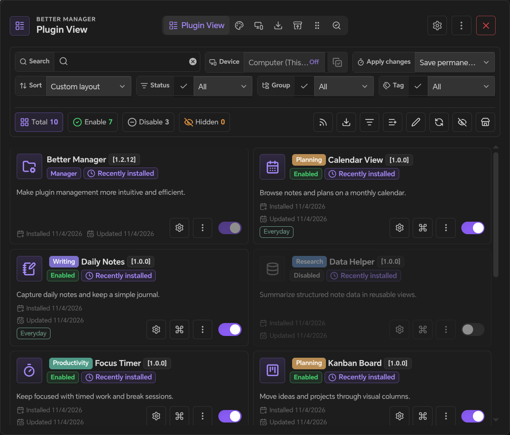
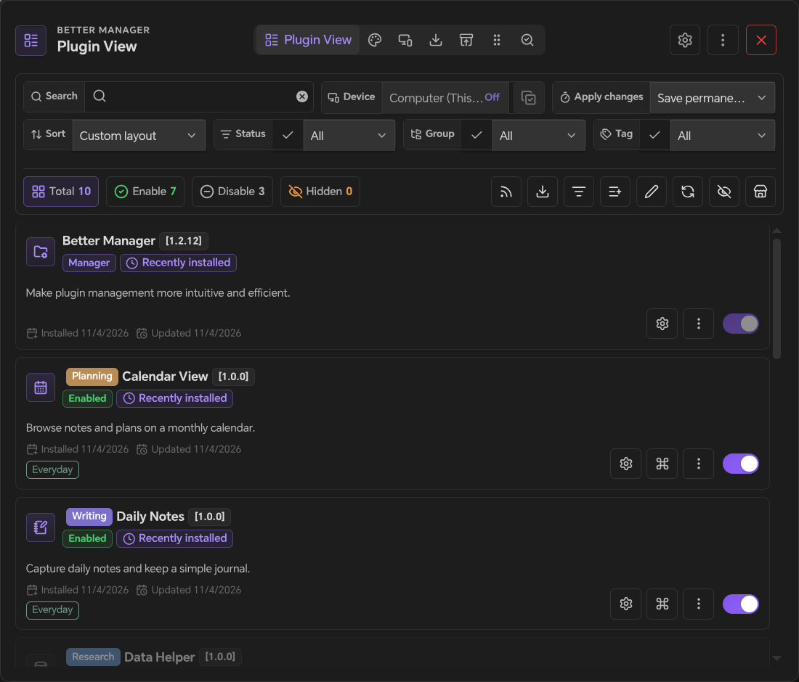
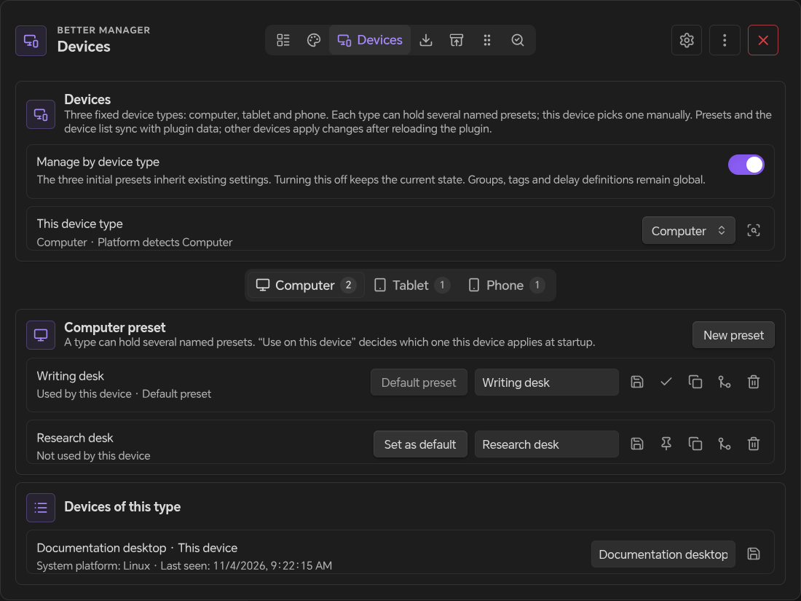
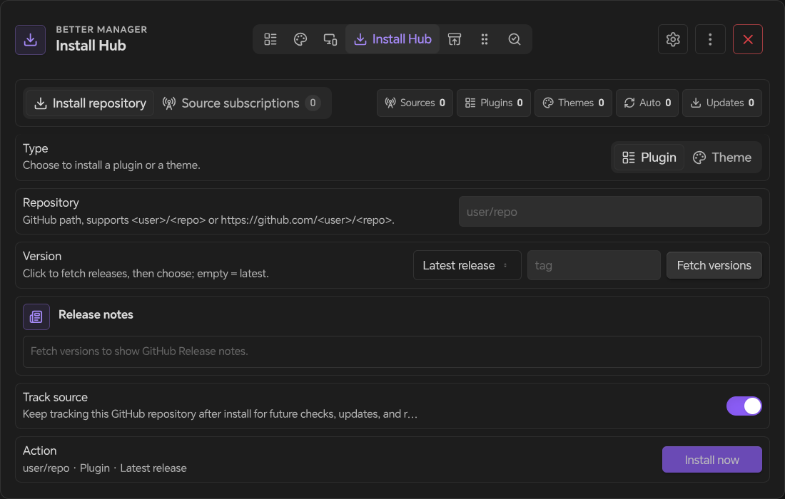
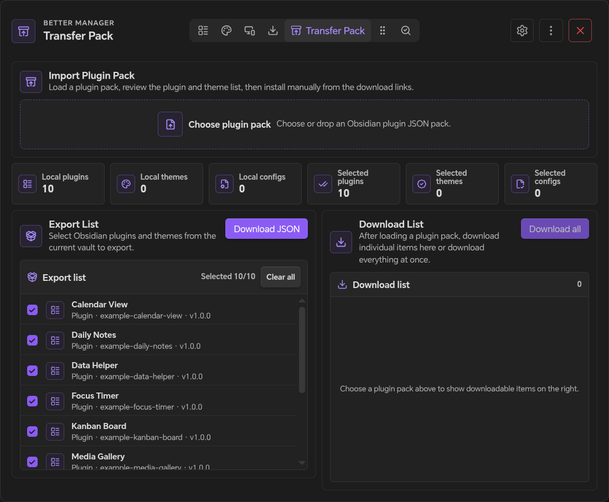
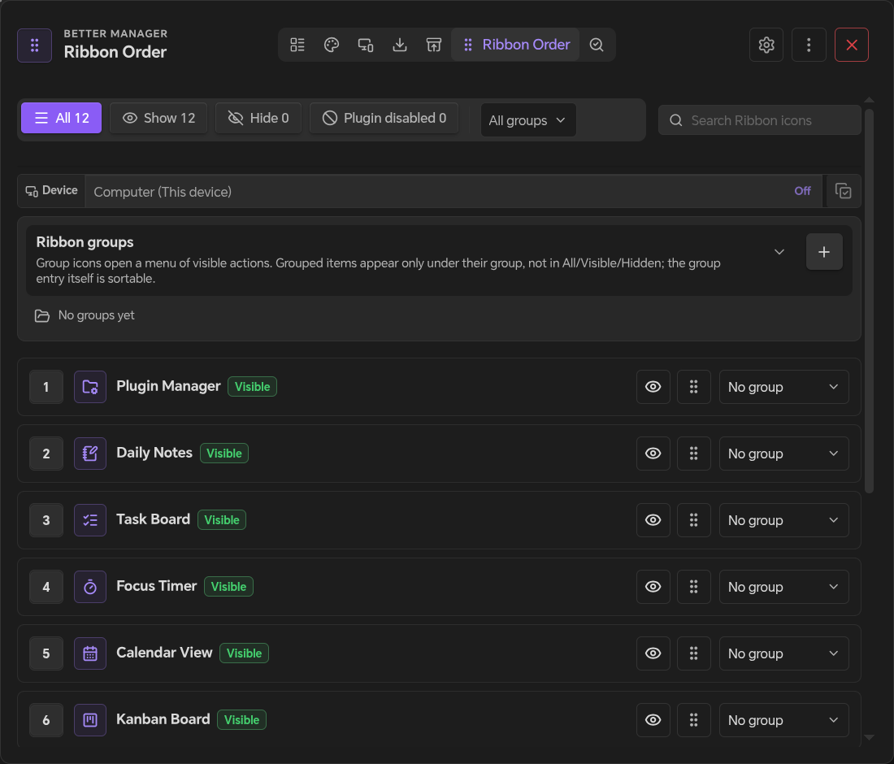
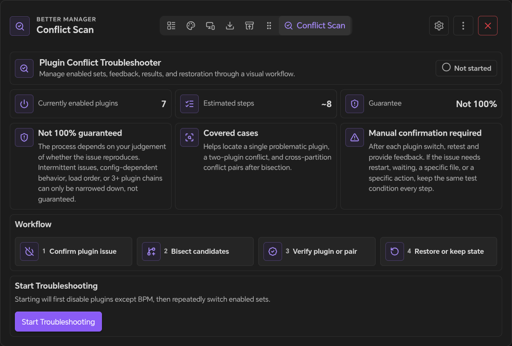
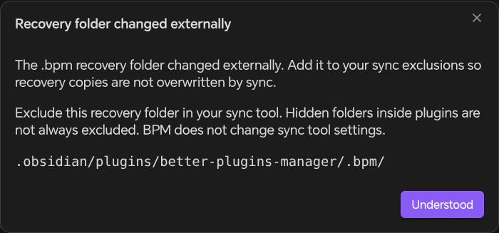

# Better Manager

**A more capable plugin manager for Obsidian.**

Organize your plugin workflow with delayed startup, batch controls, groups, tags, device presets and a clear management interface.

[1.2.20 release notes](docs/release-notes-1.2.20.md)

[简体中文](https://github.com/obsidian-forged/better-manager/blob/main/docs/README_CN.md) · [日本語](https://github.com/obsidian-forged/better-manager/blob/main/docs/README_JA.md) · [한국어](https://github.com/obsidian-forged/better-manager/blob/main/docs/README_KO.md) · [Español](https://github.com/obsidian-forged/better-manager/blob/main/docs/README_ES.md) · [Français](https://github.com/obsidian-forged/better-manager/blob/main/docs/README_FR.md) · [Русский](https://github.com/obsidian-forged/better-manager/blob/main/docs/README_RU.md) · [Releases](https://github.com/obsidian-forged/better-manager/releases) · [Support](https://ifdian.net/a/eondr)

            

*The screenshots below show the 1.2.12 interface; current controls and layouts may differ.*

---

## 🎯 What is BPM?

**Better Manager (BPM)** is a control center for Obsidian community plugins, designed for vaults that rely on many plugins and need more than simple enable/disable toggles.

It helps you keep startup responsive, organize plugins by workflow, install plugins from GitHub releases, and isolate conflicts when something breaks.

| 🚀 Startup | 📦 Management | 🏷️ Organization | 📥 Installation | 🔍 Diagnosis |
|------------|---------------|------------------|-----------------|--------------|
| Delayed plugin startup and startup self-checks | Batch enable/disable, quick search, and status filters | Groups, tags, notes, descriptions, and custom names | Install from GitHub repositories and release versions | Guided conflict troubleshooting with report generation |

---

## ✨ Core Features

BPM separates plugin management, appearance, devices, installation, transfer and diagnosis into focused tabs. Ribbon Order appears when Ribbon management is enabled; feature and tool visibility can be configured in settings.

| Tab | Workflow |
|-----|----------|
| 🧩 Plugin View | Manage installed plugins, metadata, filters, startup behavior, and per-plugin actions |
| 🎨 Appearance overview | Manage themes, CSS snippets and appearance presets |
| 📱 Devices | Choose device types, defaults and named presets |
| 📥 Install Hub | Install from GitHub, manage tracked sources, and optionally browse the Plugin store (Preview) |
| 📦 Transfer Pack | Export, import, and restore plugin/theme packs across vaults |
| 🎛️ Ribbon Order | Control Obsidian ribbon icon order and visibility |
| 🔍 Conflict Diagnosis | Locate plugin problems and generate troubleshooting reports |

### 🧩 Plugin View

The main tab for day-to-day plugin management.

| Area | What it does |
|------|--------------|
| **Plugin list** | Browse installed community plugins in a compact, searchable management view |
| **Batch actions** | Enable, disable, hide or unhide selected plugins, including grouped workflows |
| **Filters** | Filter by recent installation, enabled state, group, tag, delay setting, and keyword |
| **Organization** | Add custom names, descriptions, notes, groups and tags; quickly assign a group or add tags from the context menu |
| **Startup control** | Assign delayed startup presets and keep startup behavior visible from the list |
| **Plugin actions** | Check updates, download updates, restart a plugin, temporarily start a plugin, open settings, open folders, copy IDs, open repositories, clear config, hide, or delete |
| **BPM tags** | Automatically marks BPM-installed plugins with `bpm-install` and supports ignored plugins with `bpm-ignore` |

**Update controls:** Open **Update rules** from the overview toolbar, a plugin’s context menu, the version picker, or basic settings. Exclude a plugin, skip a specific release from its source, or mute automatic reminders for 1, 7 or 30 days. Rules can be reviewed and cleared, including rules for uninstalled plugins. Muting keeps available updates visible.

**Update all eligible plugins** previews each current version, target release and source, with reasons for skipped plugins. Confirm the reviewed plan to update sequentially; changed targets are skipped, failed items do not stop the remaining updates, and enabled/disabled states are retained. Results show successes, failures and skips. Commands are available for checking updates, reviewing batch updates and managing rules.

Network errors show the HTTP status and, when available, the server's explanation and retry time. Access denied is distinguished from confirmed rate limiting.

The **Recently installed** badge and status filter use the recent-install window in Basic settings, initially seven days. Setting the window to zero hides the badge.

#### Version rollback and restore points (Preview)

Open **Version rollback and restore points (Preview)** from a plugin's restore button, its store details, or Basic settings. **Keep previous plugin builds** is off by default and carries a Preview label. Enable it to keep the build and `data.json` before subsequent BPM installations or updates, or create a named restore point yourself. Creating a point briefly reloads a running plugin to capture its latest settings. Automatic retention defaults to ten points per plugin; manually created or named points are kept until deleted.

A restore preview shows the target version and original source binding. Restoring keeps the current `data.json` by default and does not restore other plugin data files. Optional **Merge current settings into the older structure** retains matching current values, removes fields absent from the older sample, and fills missing or incompatible fields from the point. Review the removed/replaced fields and resulting configuration; selected object paths can keep their entire current contents. Historical samples are not formal schemas: arbitrary migrations, renamed or moved fields, dynamic dictionaries and ambiguous array structures cannot be reversed reliably. If the reviewed files change, preview again before restoring.

Local points work offline. Restores recover the recorded source binding; a legacy point with unknown provenance clears the binding and pauses update checks until you explicitly install from a known source. Snapshots may contain sensitive settings; see [Security and Disclosure](#security-and-disclosure). Better Manager itself must be updated through Obsidian's native controls.

### 🎨 Appearance overview

Manage themes, CSS snippets and appearance presets together. Choose a device preset and apply appearance changes for the current session or save them permanently. On phones, the appearance category selector is a full-width dropdown.

### 📱 Device management

Open **Devices** in the manager (on mobile: choose **Devices** from the current-view menu). Enable **Manage by device type**, then check this device's type. Device types are fixed to **Computer**, **Tablet** and **Phone**; each type can hold several named presets and starts with one that inherits your current settings. Enabling this feature is optional.

Each preset stores plugin enabled states, assigned delay groups, appearance, and Ribbon visibility/order. The **Devices** page manages this device's type, preset creation/duplication/renaming/deletion, and which preset this device uses; any preset can reuse another preset's settings. When a type has not been configured yet and exactly one configured preset exists in another type, it is adopted automatically; with several candidates nothing is chosen for you — use **Reuse another preset's settings** on the Devices page. The device list is informational. The manager itself and BPM-ignored plugins are excluded from device-specific plugin switching. Group/tag metadata and delay definitions stay global. Desktop-only plugins are never started by the device manager on mobile.

The three scoped tabs — **Plugins**, **Appearance** and **Ribbon** — carry the same **Configure for device** selector, listing named presets grouped by device type. Editing the preset this device uses applies to the current session. In **Save permanently** mode, use **Save** in the top bar to persist preset changes by default; edits to other presets remain local drafts until saved. In **This session only** mode, plugin and appearance changes affect the current session without changing the saved preset or activating Save. Switching back to permanent mode does not save earlier session changes. Plugin enable/delay, appearance (theme and CSS snippet states), and Ribbon visibility/order are stored per preset; install sources, import/export, troubleshoot, groups, tags and delay definitions stay global.

Device records are kept in one small file per device in the plugin's `data/devices/` directory, so every device sees the others after syncing; the preset this device uses stays local. Names default to the desktop hostname or the mobile model and can be edited. The local identity stays in Obsidian's device-local storage. The device type is detected from Obsidian's platform information and can be corrected manually or with **Detect again from platform**. When the platform identifier refreshes (sync system or software update), the old device record is migrated to the new identifier and the locally stored preset choice is kept; if that preset was deleted elsewhere, the device falls back to the default preset of its type and says so. There is no per-device configuration: mobile has no stable long-lived device identifier, so per-device forks cannot be reconciled after syncing. To tell two devices of the same type apart, create multiple named presets and pick one on each device. Reinstalling or clearing local data can create a new device record; just pick a preset again.

Open BPM views retain their editing snapshot and local draft. See [Saving settings and resolving conflicts](#saving-settings-and-resolving-conflicts) for persistent changes and source selection across devices. Filesystem conflicts remain the responsibility of your sync provider.

#### Why a mobile device can appear more than once

Mobile platforms do not give web or plugin code a stable hardware identifier:

- Obsidian may not expose Capacitor's Device bridge at all. When it does, `getId()` is an app/vendor-scoped value, not a physical-device serial; it can change after clearing app data, reinstalling the app, moving to a new WebView data directory, or an OS/vendor migration.
- The fallback is a UUID kept in Obsidian's device-local storage. It survives normal restarts, reloads and software updates, but not clearing app storage or reinstalling the app.
- Device-local storage belongs to one installation, not to the physical device, and is never synced.
- BPM stores only a hash of the platform identifier, uses it for the device list and to remember this installation's preset choice, and never keys configuration by device id. A duplicate or removed record therefore does not change presets, their contents, or which preset another installation uses.
- To treat two installations as the same device, rename or remove the stale record manually and pick the same named preset on each installation. Per-device configuration is intentionally absent because it cannot be reconciled reliably after syncing.

Native Obsidian plugins can start before the manager applies a preset. Use the existing delayed-start mode and startup takeover if you need the manager to control startup ordering. Missing plugins and unavailable Ribbon icons retain their saved choices. Reorder Ribbon items using the up/down buttons on touch devices.

### 📥 Install Hub

The Install Hub handles GitHub-based installation and the sources BPM can track after installation.

| Area | What it does |
|------|--------------|
| **Install type** | Switch between plugin and theme installation |
| **Repository input** | Accepts `user/repo` or full GitHub repository URLs |
| **Release selection** | Fetch available GitHub releases and install latest or a selected version |
| **Release notes** | Shows release information before installation when available |
| **Recent installs** | Keeps recently used repositories for faster repeated installs |
| **Source tracking** | Optionally tracks installed repositories for later checks, updates, and reinstalls |
| **Source management** | Review tracked plugin/theme sources, update targets, reinstall items, and keep source metadata current |

#### Plugin store (Preview)

Enable **Plugin store (Preview)** under **Basic → Personalize BPM** to show its compass action in Plugin View. The store is opt-in; enabling its entry does not start a background catalog download. Opening it loads saved sources and, when none exist, fetches the official community directory. Sources can then be refreshed explicitly.

Browse discovery suggestions or search the catalog, with source, installed-state, open/closed-source, download-count and maintenance filters. Details show the source, compatibility declarations, starter material and release history. Repository metadata and README content are fetched on request; screenshots and documentation can contact their remote image hosts. The try list stores plans and experience notes only; it does not provide an isolated trial environment or automatically restore a tried plugin.

Add independent sources using a URL, pasted JSON or a selected file. Validate the preview before importing; the reviewed snapshot is imported without fetching a different copy. See the [source format example](docs/catalog-source.example.json). Same-ID entries retain separate source identities. Independent sources are not reviewed merely because they appear in this store; choose sources you trust.

Use the version picker to install a historical GitHub release or an independent-source release that provides `manifest.json` and `main.js`. Replacing an installed plugin's source requires confirmation. Installation checks identity, Obsidian compatibility, mobile restrictions and update-exclusion rules, and rechecks the reviewed source binding, selected URLs and manifest version before replacement. It retains enabled/disabled state and current configuration. Historical releases may disappear, and older code may not understand newer settings. Use a local restore point when you need a retained build; installing an older release alone does not restore its settings. HTTP failures remain visible, including release-specific metadata failures.

### 📦 Transfer Pack

The Transfer Pack tab exports plugin setups and imports them into another vault.

| Area | What it does |
|------|--------------|
| **Export list** | Select local plugins and themes to include in a JSON transfer pack |
| **Plugin configs** | Export selected plugin configuration files when needed |
| **Taxonomy** | Export BPM groups, tags, and delay presets |
| **Layout data** | Export manager order, hidden items, and ribbon layout |
| **Sources** | Export GitHub repository maps, source subscriptions, and install history |
| **Workspace preferences** | Export style, delay mode, tag display, and startup-check preferences |
| **Import preview** | Load a pack, review bundled plugins, themes, sources, configs, and layout data before applying |
| **Restore options** | Install missing plugins/themes, merge plugin config, restore enabled state, apply layout, merge sources, and import themes |

### 🎛️ Ribbon Order

The Ribbon Order tab keeps Obsidian's left ribbon predictable, especially when delayed plugins register icons after startup.

| Area | What it does |
|------|--------------|
| **Icon ordering** | Drag ribbon items into a stable order |
| **Visibility control** | Show or hide individual ribbon icons |
| **Status and group filters** | Combine Show, Hide and Plugin disabled; selecting all three returns to All. Disabled-plugin icons belong only to the disabled state |
| **Native sync mode** | Manages ribbon layout in BPM data without relying on Obsidian workspace config |
| **Reset action** | Show all ribbon items and sort them by name |
| **Reload guidance** | Prompts for reload when hidden startup icons need Obsidian to refresh |

On phones, status and group selectors share a row, and search uses the full row below. The status selector supports multiple choices with icons and counts. Consecutive search edits keep the same input focused; touch scrolling does not select an item. Ribbon groups scroll with the list rather than remaining pinned above it.

### 🔍 Conflict Diagnosis

The Conflict Diagnosis tab guides plugin conflict testing step by step, keeping the tested state and result in one place.

| Area | What it does |
|------|--------------|
| **Pre-check** | Confirms whether the issue still appears when other plugins are disabled |
| **Binary narrowing** | Uses guided split testing to reduce the suspect plugin set |
| **Conflict pair search** | Helps locate two-plugin conflicts, including cross-group cases |
| **Manual feedback loop** | Asks you to test each step and mark whether the problem still exists |
| **State controls** | Undo the previous step, restart Obsidian, exit troubleshooting, restore the original state, or keep the current state |
| **Result report** | Generates a Markdown conflict report with the detected plugins and suggested next actions |

---

## 📦 Installation

### Community Plugins

Recommended for most users.

1. Open **Obsidian Settings → Community Plugins**.
2. Search for **Better Manager**.
3. Install and enable the plugin.

### Manual Install

Use this when you want to install a GitHub release directly.

1. Download the [latest release](https://github.com/obsidian-forged/better-manager/releases).
2. Copy `main.js`, `manifest.json`, and `styles.css` into `.obsidian/plugins/better-plugins-manager/`.
3. Restart Obsidian.
4. Enable **Better Manager** from **Settings → Community Plugins**.

---

## 🚦 Quick Start

### Open BPM

After enabling the plugin, open BPM in either way:

- Click the BPM icon in the left ribbon.
- Run **Open the plugin manager** from the command palette.

### First Steps

1. Start in **Plugin View** to review installed plugins, filters, groups, tags, and delay settings.
2. Use **Install Hub** when installing plugins or themes from GitHub.
3. Use **Transfer Pack** when moving a plugin setup between vaults.
4. Use **Conflict Diagnosis** when a plugin issue needs guided isolation.

### Interaction Tips

- **Left-click** primary controls to toggle, edit, install, import, or run an action.
- **Right-click** a plugin item to open its context menu.
- **Hover** toolbar buttons to see tooltips; on touch devices, use long press where supported.
- **Better Manager settings** is in the top-right **More** menu. Close remains a separate button. On phones, full-width dropdowns replace wide overview, source and appearance toolbars; the current-view menu switches manager pages.
- **Save persistent changes** with **Save changes**, immediately to the left of **More**, in the default manual mode. If manual saving is disabled, the immediate save action stays in **More**. See the save workflow below.
- **Toolbar labels** show the current page by default; hover reveals the other labels. Change this behavior in **Settings → Style**.

### Saving settings and resolving conflicts

**Save settings manually** is enabled by default. Persistent edits stay in a recoverable local draft until **Save changes** checks the latest shared configuration and publishes them; the save control highlights pending changes. Closing the editor retains the draft. Turn this setting off to save when the last BPM editing window closes, through the same conflict checks. Reopening an editor cancels a close save that has not committed. With configuration sync protection enabled, a newer shared revision delivered by the sync tool is taken over automatically when this device has no unsaved user edits; opening the manager or settings also checks for it, so the newest configuration appears without pressing Save. The save control only highlights changes made on this device.

**Apply changes → This session only** affects the current session without modifying the saved preset or creating pending changes. Switching back to permanent mode does not save earlier session-only adjustments. These save controls apply to BPM configuration; explicit plugin installations, restores and imports remain their own file-changing actions.

When configurations differ and this device has unsaved user edits, the conflict dialog opens as soon as the conflict is detected, including at startup, instead of waiting for a Save click. The notification area carries the conflict warning icon; feature menus identify affected pages with text. Source chips beside affected items let you preview and choose local or remote values without changing the running plugin state. The dialog retains section choices and offers three outlined, fully rounded footer actions in one row:

- **Local version · All settings** applies and saves the local version for every configuration section and related file.
- **Remote version · All settings** applies and saves the remote version for every configuration section and related file.
- **Save changes** confirms and saves your individual choices.

If a newer conflict arrives before confirmation, review the preserved versions again. **Warn about frequent external changes** is a separate optional reminder; it does not refresh the editor, pause saving or establish that a sync loop exists.

---

## Security and Disclosure

BPM is a local Obsidian plugin manager, but some features intentionally use external services or browser APIs:

- **External network requests**: BPM contacts GitHub for user-visible plugin management features such as fetching community plugin metadata, resolving repositories, checking releases, and installing or updating plugins/themes. These requests may use `github.com`, `api.github.com`, and `raw.githubusercontent.com`. When a plugin exposes no local icon, BPM also queries the Obsidian community directory search index at `community.obsidian.md` for the Lucide icon name it assigns to that plugin. Repository, homepage and release links open only when clicked. The project tutorial on `www.bilibili.com` also opens only when clicked.
- **Store and independent sources**: The Plugin store (Preview) is opt-in. Opening an empty store fetches the official directory; source refreshes, repository documentation and release downloads contact their respective services. Independent catalogs and their release/image URLs may use additional HTTPS domains supplied by the source. Configured GitHub proxies receive the requests routed through them. GitHub credentials are not forwarded to independent catalog/file hosts or third-party proxies. Imported source files and repository documentation are data; installing a plugin runs that publisher's code in Obsidian.
- **Accounts and data collection**: BPM requires no account or paid subscription and adds no telemetry. A GitHub token is optional for authenticated GitHub access; private repositories need appropriate access. Catalog browsing and downloads do not upload configuration snapshots or vault notes.
- **Selected local files**: A catalog JSON file chosen with the system file picker may be outside the vault. BPM reads that selected file to validate and import its catalog; it does not upload the file. Transfer packs can include plugin settings, so review their contents before sharing them.
- **Clipboard access**: BPM writes to the system clipboard only when the user clicks **Copy ID** for a plugin.
- **Vault file access**: BPM reads plugin/theme metadata, selected plugin configuration files, transfer packages, and legacy export folders for management, migration, backup, import/export, and troubleshooting features. It does not upload vault notes to a remote service.
- **Device records**: When device management is used, BPM writes one small JSON file per device into the plugin's data directory (`.obsidian/plugins/better-plugins-manager/data/devices/<id>.json`) so devices can list each other after syncing. These files contain only a device id, display name, device type, and last-seen timestamp — no notes, plugin settings, or credentials. They are written with Obsidian's vault adapter, never outside the vault, and removed when the device is removed from the list.
- **Icon fallback**: Plugin icons first use Obsidian's registered icons. If a named Lucide icon is unavailable locally, BPM downloads its SVG from the official `lucide-icons/lucide` GitHub repository. Before falling back to the default plug icon, BPM asks the Obsidian community directory which Lucide icon it assigns to the plugin and resolves that name the same way. SVGs and colour rules are stored in `data/icons.css` for reuse offline. Requests contain only the icon name, without vault content or credentials. Rebuildable repository and catalogue caches live in `cache/`. The native `data.json` settings file stays in place. Existing device and cache files are migrated automatically.
- **Plugin restore points**: Optional previous-build retention stores `manifest.json`, `main.js`, `styles.css`, `data.json` and source information as local JSON under the BPM plugin's `data/history/` directory. These files are not encrypted by BPM and can contain credentials or other sensitive plugin settings. They may be copied by your sync or backup provider; decide whether to include this directory. Restore points and the separate `.bpm/` recovery copies are not a full vault backup. Structural settings merges cannot guarantee reversal of a plugin author's migrations.
- **Single-machine mode and configuration sync protection**: By default BPM only reads and writes `data.json`, keeps device records there, and does not create `.bpm`; this suits vaults used on one device without sync. Before saving, single-machine mode merges local edits onto the latest settings from other devices and adopts external changes while idle, so it does not blindly overwrite them; a failed or temporarily missing read never falls back to defaults. When a sync service is detected, background automatic writes stay pending and only an explicit Save merges and writes; a first installation creates `data.json` only on an explicit Save, and an established file that is temporarily missing or empty is never recreated by a background write or restart. When Obsidian Sync, iCloud, Syncthing or a similar tool syncs this vault in real time across devices, enable **Enable configuration sync protection** in Basic settings. The switch is device-local: it is not written to `data.json`, does not affect other devices, and applies after restarting Obsidian. It then keeps local drafts, conflict copies and interrupted-save recovery, and preserves content-addressed copies of BPM settings, device records, icon rules and related Obsidian configuration files in the plugin's `.bpm/<local-id>/` folder (unchanged copies are reused). Choosing cache deletion when turning protection off removes only this device's own cache directory after the next single-machine start. A legacy switch stored in `data.json` is migrated once; new-format files without the field are treated as protected only when they carry a revision marker or a local `.bpm` exists, and fresh installs start with protection off. Persistent configuration edits remain recoverable local drafts. Session-only plugin and appearance adjustments stay in the current session without entering the saved preset or activating Save. With protection on, a newer revision written by another device is followed automatically when this device has no user edits; only genuine concurrent edits open the conflict dialog. By default, the top-bar **Save** action checks the latest shared configuration for conflicts and publishes the selected changes; unchanged shared files are not rewritten, and only changed content advances the configuration revision. Closing a window retains its draft in manual mode. With **Save settings manually** turned off, closing the last BPM editing window checks and saves pending persistent changes through the same conflict checks. When protection is on, exclude `.bpm/` from sync tools; if BPM detects external changes there, it reminds you to add the directory to your exclusions. The manager's **More** menu and the settings page provide a manual refresh that re-reads external settings and the plugin list without restarting. Snapshots can contain credentials; BPM does not upload them. Obsidian's shared configuration files are backed up for manual recovery, not automatically rolled back.
- **Realtime sync compatibility**: Basic settings includes **Save settings manually** and **Warn about frequent external changes**, both enabled by default and labelled **Realtime sync / Compatibility**. Warnings track each BPM `data.json`, `data/icons.css` and `data/devices/*.json` file separately: at least three effective external content changes to one file within a rolling three-second window, with at most one warning per minute across all files. Local writes, unchanged content, JSON formatting and key order, revision markers, and device heartbeats are excluded. File replacement events are coalesced for 250 milliseconds. A warning does not refresh the interface, pause saving or repair configuration; it is a signal to inspect the sync tool, not proof of a sync loop. The separate reminder to exclude `.bpm/` from syncing remains active.
- **Base64 encoding/decoding**: BPM uses runtime `btoa`/`atob` to pack and restore local Transfer Pack files and decode repository documentation returned by GitHub's content API. Decoded content is treated as data, not executable code.

---

## 🔍 Conflict Diagnosis Tutorial

Use **Conflict Diagnosis** when a problem appears after enabling community plugins and you need a structured way to narrow down the cause.

### Workflow

1. Open the **Conflict Diagnosis** tab, or run **Troubleshoot plugin conflicts** from the command palette.
2. Start a diagnosis session. BPM records the current plugin state before changing anything.
3. Test your vault after each step, then choose **Problem Still Exists** or **Problem Gone**.
4. Continue through the guided split tests until BPM narrows the result to a plugin or plugin pair.
5. Review the result, restore the original plugin state or keep the current state, then generate a Markdown report if needed.

### Notes

- Diagnosis depends on your feedback at each step; use the same test action every time.
- Intermittent bugs, load-order issues, configuration-specific bugs, or conflicts involving three or more plugins may still need manual verification.
- You can undo the previous step, restart Obsidian during testing, exit the session, restore the original state, or keep the current state.

---

## 🛡️ Startup Takeover

When **Delayed Startup** is enabled, BPM checks `.obsidian/community-plugins.json` to make sure Obsidian and BPM are not trying to control the same plugins at startup.

| Case | BPM behavior |
|------|--------------|
| No unmanaged plugins | Starts normally |
| Unmanaged plugins detected | Shows a takeover prompt |
| Auto Takeover enabled | Moves detected plugins under BPM management automatically |
| Plugin marked `bpm-ignore` | Leaves it in Obsidian's native startup list |

Taking over keeps delayed startup, enabled state, and BPM's plugin records consistent. After a successful takeover, restart Obsidian so the startup list is applied cleanly.

---

## 📦 Transfer & Legacy Export

For current versions, use the **Transfer Pack** tab to move setups between vaults. It exports and imports plugin lists, themes, selected plugin configs, groups, tags, delay presets, layout data, ribbon order, source subscriptions, install history, and workspace preferences.

The older Markdown/frontmatter export for Obsidian Base is kept only for legacy data compatibility. New setups should use **Transfer Pack** instead of configuring a Base export folder.

---

## ⚙️ Settings

Open **More → Better Manager settings**. Settings pages have icons and descriptions; inside a page, the **Switch settings** dropdown changes categories without duplicating the navigation. The search action searches setting names and descriptions. Obsidian versions supporting native settings pages also expose this structure in their settings navigation and search.

| Page | What you can configure |
|------|------------------------|
| **Basic** | Feature/tool visibility, manual saving, external-change reminders, store Preview opt-in, previous-build retention Preview, language, persistent filters, recent-install window, delayed startup, startup/update behavior, BPM tags, Ribbon management, commands, debug mode and GitHub token |
| **Main Page Actions** | Choose which plugin actions appear directly on plugin cards and which stay in the right-click menu |
| **Style** | Plugin list layout, item display style, group/tag styles, and disabled-plugin fading |
| **Groups** | Create, rename, recolor, and delete plugin groups |
| **Tags** | Create, rename, recolor, and delete plugin tags |
| **Delay** | Create and maintain delayed-start profiles; shown only when delayed startup is enabled |

---

## ⌨️ Commands

| Command | Availability | Description |
|---------|--------------|-------------|
| **Open the plugin manager** | Always available | Opens the BPM main interface |
| **Control a plugin** | Always available | Search a plugin, then enable, disable, single-start, restart, open settings, open folder, open repository, or copy ID |
| **Save current plugin state as profile** | Always available | Saves the current enabled/disabled state as a reusable command profile |
| **Restore previous plugin state** | Available after a BPM command changes plugin state | Restores the snapshot captured before the last command-driven state change |
| **Troubleshoot plugin conflicts** | Always available | Starts the conflict diagnosis workflow |
| **Check plugin updates** | Plugin management and update controls enabled | Checks eligible plugin sources and reports available updates |
| **Preview and update all eligible plugins** | Plugin management and update controls enabled | Opens the batch-update preview before execution |
| **Update rules** | Available from the command palette | Reviews exclusions, skipped releases and reminder settings |
| **Enable/Disable selected plugin** | Optional setting | Registers one command per plugin for direct toggling |
| **One-click Enable/Disable selected group** | Optional setting | Registers group-level commands for batch toggling |
| **One-click Enable/Disable selected tag** | Optional setting | Registers tag-level commands for batch toggling |
| **Apply selected profile** | Optional setting | Registers one command per saved plugin profile |

---

## 📱 Compatibility

| Platform | Supported |
|----------|-----------|
| Windows / macOS / Linux | ✅ |
| Android | ✅ |
| iOS / iPadOS | ✅ |

The plugin automatically switches between desktop/mobile layouts based on the platform.

---

## 🤝 Contributing

Issues and PRs are welcome!

- **Bug Reports**: Please include logs and reproduction steps
- **Feature Requests**: Consider opening a discussion or issue first

## 🙏 Acknowledgments

- The ribbon sorting feature is inspired by [Obsidian-ribbon-sort](https://github.com/yunrr/Obsidian-app-ribbon-sorting)

---

## 📄 License

[MIT](https://github.com/obsidian-forged/better-manager/blob/main/LICENSE)
