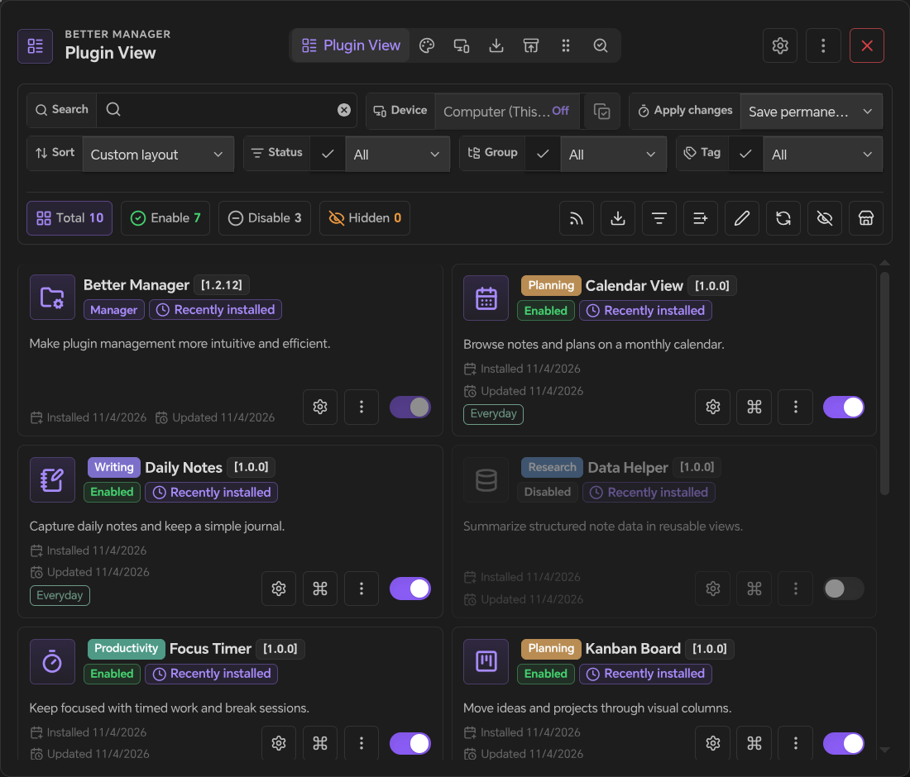
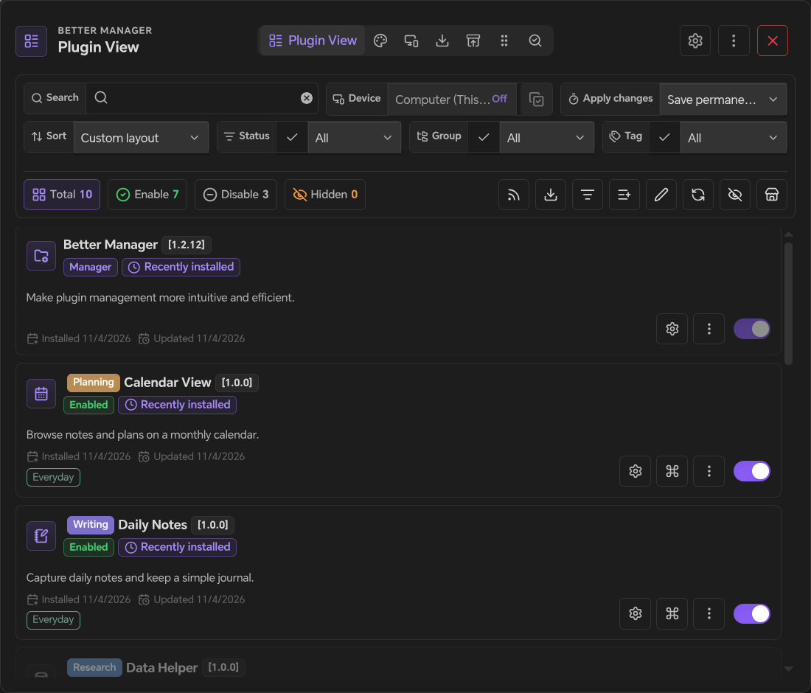
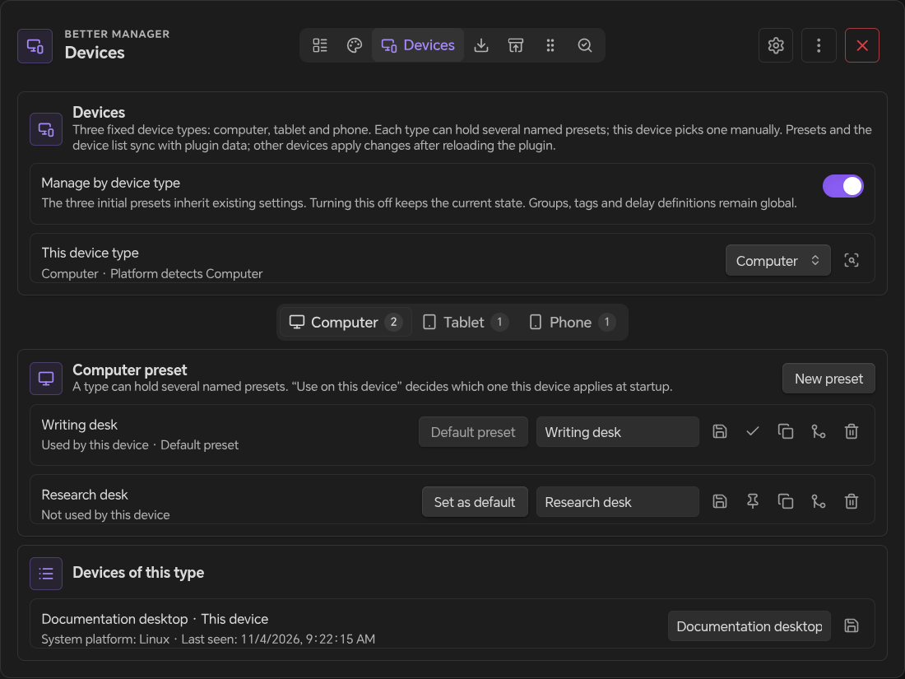
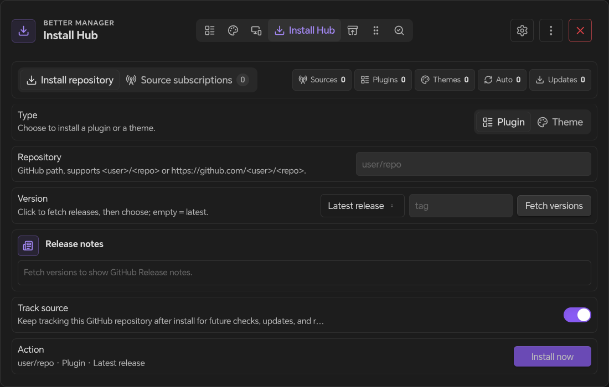
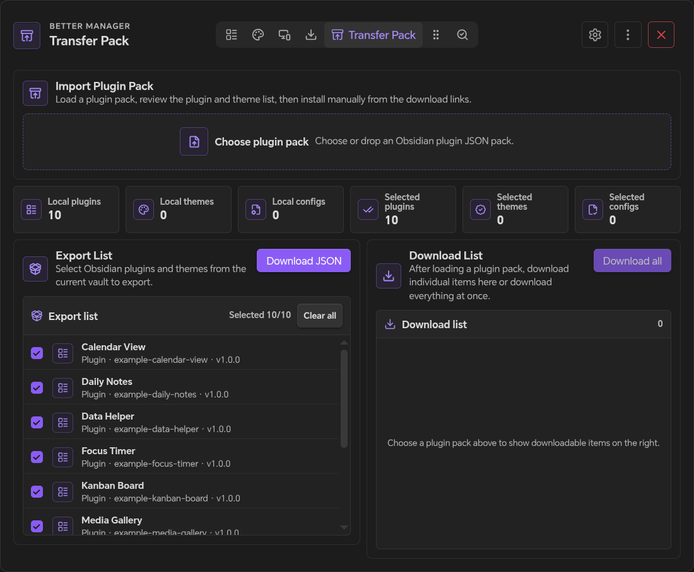
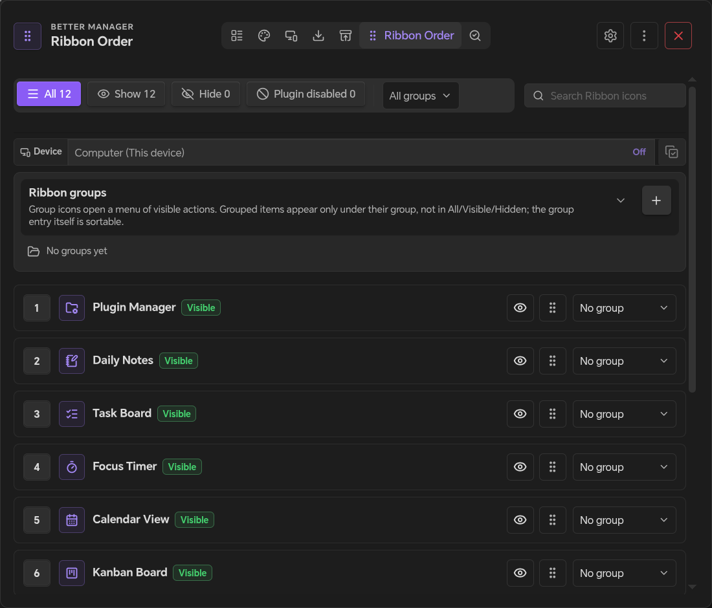
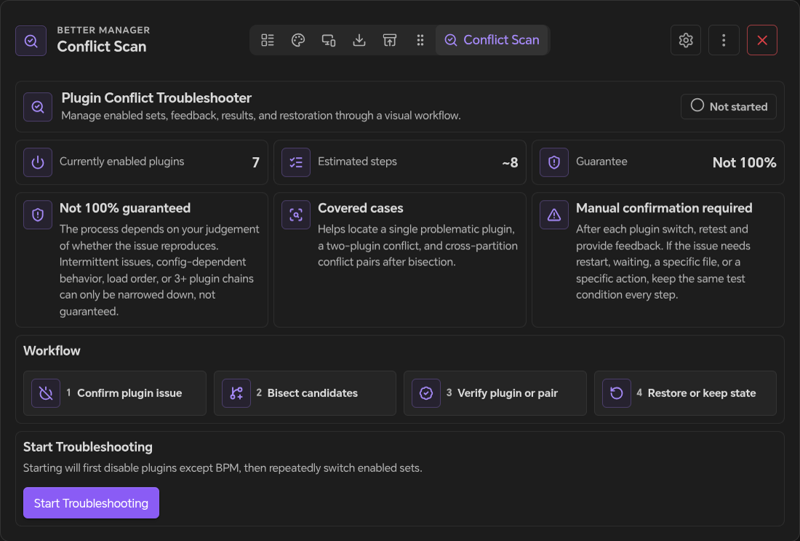
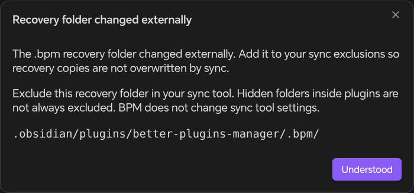

# Better Manager

**更强大的 Obsidian 插件管理器。**

用延迟启动、批量管理、分组标签、设备预设和清晰的管理界面，整理你的插件工作流。

[1.2.13 更新说明](release-notes-1.2.13.md)

[English](https://github.com/obsidian-forged/better-manager/blob/main/README.md) · [日本語](https://github.com/obsidian-forged/better-manager/blob/main/docs/README_JA.md) · [한국어](https://github.com/obsidian-forged/better-manager/blob/main/docs/README_KO.md) · [Español](https://github.com/obsidian-forged/better-manager/blob/main/docs/README_ES.md) · [Français](https://github.com/obsidian-forged/better-manager/blob/main/docs/README_FR.md) · [Русский](https://github.com/obsidian-forged/better-manager/blob/main/docs/README_RU.md) · [版本发布](https://github.com/obsidian-forged/better-manager/releases) · [支持作者](https://ifdian.net/a/eondr)

            

---

## 🎯 BPM 是什么？

**Better Manager (BPM)** 是 Obsidian 社区插件的控制中心，适合依赖大量插件、需要比简单启用/禁用更完整管理能力的库。

它可以帮助你保持启动响应速度，按工作流整理插件，从 GitHub Release 安装插件，并在出现问题时定位冲突来源。

| 🚀 启动 | 📦 管理 | 🏷️ 整理 | 📥 安装 | 🔍 诊断 |
|--------|--------|----------|---------|---------|
| 插件延迟启动和启动自检 | 批量启用/禁用、快速搜索和状态筛选 | 分组、标签、备注、描述和自定义名称 | 从 GitHub 仓库和 Release 安装 | 引导式冲突排查和报告生成 |

---

## ✨ 核心功能

BPM 按插件、外观、设备、安装来源、迁移和诊断划分页面；启用 Ribbon 管理后显示边栏编排。可在设置中调整功能与工具入口的显示。

| Tab | 工作流 |
|-----|--------|
| 🧩 Plugin View | 管理已安装插件、插件信息、筛选、启动行为和单插件操作 |
| 🎨 外观总览 | 管理主题、CSS 片段与外观预设 |
| 📱 设备管理 | 设置设备类型、默认预设与命名预设 |
| 📥 Install Hub | 从 GitHub 安装插件或主题，并管理已跟踪来源 |
| 📦 Transfer Pack | 在不同库之间导出、导入和恢复插件/主题包 |
| 🎛️ Ribbon Order | 控制 Obsidian 左侧 Ribbon 图标的顺序和显隐 |
| 🔍 Conflict Diagnosis | 定位插件问题并生成排查报告 |

### 🧩 Plugin View

日常插件管理的主页面。

| 区域 | 功能 |
|------|------|
| **插件列表** | 以紧凑、可搜索的管理视图浏览已安装社区插件 |
| **批量操作** | 批量启用或禁用插件，包括按分组处理 |
| **筛选** | 按最近安装、启用状态、分组、标签、延迟设置和关键词筛选 |
| **整理信息** | 添加自定义名称、描述、备注、分组和标签 |
| **启动控制** | 分配延迟启动预设，并在列表中查看启动状态 |
| **插件操作** | 检查更新、下载更新、重启插件、单次启动、打开设置、打开目录、复制 ID、打开仓库、清空配置、隐藏或删除 |
| **BPM 标签** | BPM 安装的插件会自动标记 `bpm-install`，也支持通过 `bpm-ignore` 忽略管理 |

**更新控制：** 可从总览工具栏、插件右键菜单、版本选择器或基础配置打开“更新规则”，排除某个插件、跳过其安装来源中的指定版本，或将自动提醒静音 1、7、30 天。规则可随时查看和清除，也会保留已卸载插件的规则供检查。静音不隐藏可用更新。

“一键更新可用插件”会先列出当前版本、目标 release、安装来源及跳过原因。确认预览后按顺序安装，目标发生变化时跳过，单项失败后继续其余更新，并保留插件启停状态。完成后显示成功、失败和跳过汇总。命令面板也提供检查更新、预览批量更新和管理规则入口。

网络获取失败会显示 HTTP 状态码，以及服务端提供的原因和重试时间；有明确限流依据时才按限流处理。

### 🎨 外观总览

集中管理主题、CSS 片段与外观预设。可按设备选择预设，并决定外观改动仅在本次会话生效还是永久保存。

### 📱 设备管理

在管理器打开「设备管理」（移动端：从当前视图菜单选择「设备管理」），开启「按设备类型管理」，确认本机类型。设备类型固定为「电脑、平板、手机」三类；每类可以保存多份命名预设，初始各有一份并继承现有配置；默认不开启接管。

每份预设分别保存插件开关、延迟档位、外观和 Ribbon 显隐与顺序。设备管理页负责本机类型、预设的新建/复制/改名/删除、以及选择本机套用哪一份；每份预设都可以从其他预设复用配置。某个类型还没有配置时，如果其他类型只有一份已配置预设会自动套用；有多份时不会擅自选择，可在设备页用「复用其他预设的配置」手动挑选。设备清单只作展示。管理器自身与 BPM 忽略的插件不参与设备切换；分组、标签、延迟档位定义仍为全局配置。设备管理器不会在移动端启动仅支持桌面的插件。

「插件总览、外观总览、边栏编排」三栏顶部都有同一个「按设备配置」下拉，按类型分组列出命名预设。编辑本机正在使用的预设会在当前会话中生效；「持久保存」模式下，默认点击顶栏「保存」后才持久化配置，其他预设的编辑在保存前保留为本机草稿。「仅本次会话」模式下的插件和外观调整只影响当前会话，不写入预设，也不触发保存；切回持久模式不会补存先前的临时调整。插件开关与延迟档位、外观（主题与 CSS 片段开关）、Ribbon 显隐与顺序按预设独立保存；安装来源、导入导出、冲突诊断，以及分组、标签、延迟档位定义保持全局。

设备记录按「每台设备一个小文件」保存在插件的 `data/devices/` 目录里，同步后各设备就能互相出现在清单中；本机选用的预设仍只存在本地。名称默认取桌面主机名或移动端型号，可手动修改；本机类型按 Obsidian 平台信息自动识别，可在设备页手动指定或「按平台重新检测」。平台标识刷新（同步系统或软件更新）时会把旧设备记录迁移到新标识，本机选择的预设存在本地、不受影响；若该预设已被其他设备删除，会回退到同类型默认预设并提示。不提供单设备配置：移动端没有可靠的长期设备标识，按设备分叉会让同步后的配置无法对账。需要区分同类设备时，用多份命名预设并在各设备上各选一份。清除应用数据或重装可能产生新的设备记录，重新选择预设即可。打开的 BPM 界面保留当前编辑快照和本机草稿。点击顶栏「更多」左侧的「保存」，才会对照最新共享配置检查冲突。冲突项目旁的来源胶囊可预览本机或远端配置，不立即改变插件运行状态；选择需要的版本后，再点击「保存」。默认关闭窗口会保留草稿，不提交到共享配置；在基础配置关闭「仅手动保存配置」，则改为关闭最后一个 BPM 编辑窗口时检查并保存。文件系统冲突仍由同步工具处理。

#### 移动端设备为什么可能出现重复记录

移动平台不会向网页或插件提供稳定的硬件唯一标识：

- Obsidian 不一定暴露 Capacitor 的 Device 桥接；即使可用，`getId()` 也是应用/厂商作用域的值，不是物理设备序列号。清除应用数据、重装应用、切换 WebView 数据目录，或系统/厂商迁移都可能改变它。
- 兜底方案是保存在 Obsidian 本地存储中的 UUID。它能跨普通重启、插件重载和软件更新保留，但清除应用存储或重装就会丢失。
- 本地存储属于一次安装，而不是物理设备本身，也不会随同步数据迁移。
- BPM 只保存平台标识的哈希，用它展示设备列表并记住本次安装选用的预设，从不把配置绑定到设备 id。因此出现重复记录或删除旧记录，都不会改变预设内容，也不会影响另一台安装选择哪份预设。
- 如果希望把两次安装视为同一台设备，请手动改名或删除旧记录，并在两边选择同一份命名预设。不提供单设备配置，因为同步后无法可靠对账。

Obsidian 原生启用的插件可能先于管理器启动；若需要接管启动顺序，请配合现有延迟启动和启动接管功能。未安装插件与暂不可用的 Ribbon 图标会保留配置。触屏通过上下移动按钮调整 Ribbon 顺序，无需拖拽。

### 📥 Install Hub

Install Hub 负责从 GitHub 安装插件/主题，并管理安装后可跟踪的来源。

| 区域 | 功能 |
|------|------|
| **安装类型** | 在插件和主题安装之间切换 |
| **仓库输入** | 支持 `user/repo` 或完整 GitHub 仓库 URL |
| **版本选择** | 获取 GitHub Release，可安装最新版或指定版本 |
| **更新说明** | 可用时在安装前显示 Release 信息 |
| **最近安装** | 保存最近使用的仓库，便于重复安装 |
| **来源跟踪** | 可选择跟踪已安装仓库，用于后续检查更新、更新和重装 |
| **来源管理** | 查看已跟踪的插件/主题来源、更新目标、重装项目，并保持来源元数据最新 |

### 📦 Transfer Pack

Transfer Pack 用于在不同 Obsidian 库之间迁移插件配置，不需要手动整理清单。

| 区域 | 功能 |
|------|------|
| **导出列表** | 选择本地插件和主题，生成 JSON 迁移包 |
| **插件配置** | 按需导出选中的插件配置文件 |
| **分类数据** | 导出 BPM 分组、标签和延迟预设 |
| **布局数据** | 导出管理器排序、隐藏项目和 Ribbon 布局 |
| **来源数据** | 导出 GitHub 仓库映射、来源订阅和安装历史 |
| **工作区偏好** | 导出样式、延迟模式、标签显示和启动检查偏好 |
| **导入预览** | 导入前预览包内插件、主题、来源、配置和布局数据 |
| **恢复选项** | 安装缺失插件/主题、合并插件配置、恢复启用状态、应用布局、合并来源和导入主题 |

### 🎛️ Ribbon Order

Ribbon Order 保持 Obsidian 左侧 Ribbon 顺序稳定，尤其适合延迟启动插件在启动后才注册图标的情况。

| 区域 | 功能 |
|------|------|
| **图标排序** | 拖动 Ribbon 项目并固定顺序 |
| **显隐控制** | 显示或隐藏单个 Ribbon 图标 |
| **原生同步模式** | 将 Ribbon 布局保存在 BPM 数据中，不依赖 Obsidian workspace 配置 |
| **重置操作** | 显示所有 Ribbon 项目并按名称排序 |
| **重载提示** | 当启动时隐藏的图标需要 Obsidian 刷新时给出提示 |

### 🔍 Conflict Diagnosis

Conflict Diagnosis 通过步骤引导插件冲突测试，并把测试状态和结果保存在一个页面中。

| 区域 | 功能 |
|------|------|
| **预检查** | 确认禁用其他插件后问题是否仍然存在 |
| **二分缩小范围** | 通过分组测试缩小嫌疑插件范围 |
| **冲突对查找** | 帮助定位两个插件之间的冲突，包括跨分组情况 |
| **人工反馈循环** | 每一步测试后由你确认问题是否仍然存在 |
| **状态控制** | 撤销上一步、重启 Obsidian、退出排查、恢复原始状态或保留当前状态 |
| **结果报告** | 生成包含检测结果和建议操作的 Markdown 冲突报告 |

---

## 📦 安装

### 社区插件市场

推荐大多数用户使用。

1. 打开 **Obsidian 设置 → 第三方插件**。
2. 搜索 **Better Manager**。
3. 安装并启用插件。

### 手动安装

适合直接安装 GitHub Release。

1. 下载 [latest release](https://github.com/obsidian-forged/better-manager/releases)。
2. 将 `main.js`、`manifest.json` 和 `styles.css` 复制到 `.obsidian/plugins/better-plugins-manager/`。
3. 重启 Obsidian。
4. 在 **设置 → 第三方插件** 中启用 **Better Manager**。

---

## 🚦 快速开始

### 打开 BPM

启用插件后，可以通过以下方式打开 BPM：

- 点击左侧 Ribbon 中的 BPM 图标。
- 在命令面板中运行 **Open the plugin manager**。

### 首次使用建议

1. 从 **Plugin View** 开始，查看已安装插件、筛选、分组、标签和延迟设置。
2. 安装 GitHub 插件或主题时使用 **Install Hub**。
3. 在不同库之间迁移插件配置时使用 **Transfer Pack**。
4. 需要定位插件问题时使用 **Conflict Diagnosis**。

### 交互提示

- **左键** 点击主要控件进行切换、编辑、安装、导入或执行操作。
- **右键** 插件项目打开上下文菜单。
- **悬停** 工具栏按钮查看提示；触屏设备可使用长按提示。
- **保存持久修改**：点击顶栏「更多」左侧的「保存」。默认关闭 BPM 会保留本机草稿，不写入共享配置；在基础配置关闭「仅手动保存配置」，则改为关闭最后一个 BPM 编辑窗口时检查并保存。「生效方式 → 仅本次会话」下的插件和外观调整不产生待保存修改，无需点击保存；切回持久模式不会补存这些临时调整。
- **工具栏标签** 默认仅当前页显示，悬停可查看其他标签；可在 **设置 → 样式** 调整。

---

## 安全与披露

BPM 是一个本地 Obsidian 插件管理器，但部分功能会有意使用外部服务或浏览器 API：

- **外部网络请求**：BPM 在用户可见的插件管理功能中访问 GitHub，例如获取社区插件元数据、解析仓库、检查 release，以及从 GitHub 安装或更新插件/主题。这些请求可能使用 `github.com`、`api.github.com` 和 `raw.githubusercontent.com`。当插件本地没有可用图标时，BPM 还会查询 Obsidian 社区目录（`community.obsidian.md`）的搜索索引，读取社区为该插件分配的 Lucide 图标名。仓库、主页和发布链接仅在点击时打开；项目教程链接同样仅在点击时打开。
- **剪贴板访问**：BPM 仅在用户点击插件的 **Copy ID** 时写入系统剪贴板。
- **Vault 文件访问**：BPM 会读取插件/主题元数据、用户选中的插件配置文件、迁移包和旧版导出文件夹，用于管理、迁移、备份、导入/导出和冲突排查。BPM 不会把 vault 笔记上传到远程服务。
- **设备记录**：启用设备管理后，BPM 会为每台设备在插件数据目录写一个小型 JSON 文件（`.obsidian/plugins/better-plugins-manager/data/devices/<id>.json`），用于同步后让各设备互相出现在设备清单里。文件只包含设备 id、显示名称、设备类型和最近上线时间，不含笔记、插件配置或凭据；写入走 Obsidian 的 vault adapter，不访问 vault 外部；从列表移除设备时会删除对应文件。
- **图标兜底**：优先使用 Obsidian 已注册的图标；指定的 Lucide 图标在本地不存在时，从官方 `lucide-icons/lucide` GitHub 仓库下载 SVG。落到默认插头图标前，BPM 还会查询 Obsidian 社区目录为该插件分配的 Lucide 图标名，并按同样方式解析。SVG 与颜色规则保存到 `data/icons.css`，供离线复用。请求仅含图标名，不含 vault 内容或凭据。可重建的仓库和目录缓存保存在 `cache/`；原生 `data.json` 设置文件保留原位。已有设备与缓存文件会自动迁移。
- **配置保护**：每次启动都会把 BPM 设置、设备记录、图标规则及相关 Obsidian 配置保存为插件内 `.bpm/<local-id>/` 的内容快照，相同内容复用已有副本。永久配置的编辑先暂存为可恢复的本机草稿；仅本次会话的插件和外观调整不写入预设，也不触发保存。默认点击顶栏「保存」才会检查最新共享配置的冲突并写入所选修改；共享文件未变时不重写，仅内容变化才产生新的配置修订。并发版本分别保留，等待明确选择。手动模式下关闭窗口不提交草稿；关闭「仅手动保存配置」后，在最后一个 BPM 编辑窗口关闭时按相同冲突规则检查并保存待保存的持久修改，重新打开编辑器会取消尚未提交的关闭保存。外部配置变化不会打断编辑或触发自动恢复。本机恢复锚点保存在 Obsidian 的设备本地存储中。快照可能包含凭据等敏感配置，BPM 不会上传；请在外部同步工具中排除 `.bpm/`，插件内的隐藏目录不保证会被所有同步服务自动排除。检测到 `.bpm/` 恢复目录被外部修改时，BPM 会提醒将目录加入同步排除列表；本机正常写入不触发该提醒。Obsidian 共享配置只备份供手动恢复，不自动回滚；合法的旧版编辑缓存会迁移。
- **实时同步兼容**：基础配置提供「仅手动保存配置」和「频繁外部修改提醒」，默认均开启，带有「实时同步 / 兼容措施」标签。提醒按 BPM 的 `data.json`、`data/icons.css`、`data/devices/*.json` 分文件计算：同一文件在滚动 3 秒内至少出现 3 次有效外部内容修改才提醒，所有文件合计每分钟最多提醒一次。本机写入、内容相同、JSON 格式或键序变化、修订标记及设备心跳不计入；文件替换通知按 250 毫秒合并。提醒不会刷新界面、暂停保存或自动修复配置，只提示检查同步工具，不代表已确认同步循环。`.bpm/` 的同步排除提醒独立保留。
- **Base64 编码/解码**：BPM 运行时使用 `btoa`/`atob` 打包和恢复本地 Transfer Pack 文件，以及解码 GitHub 内容 API 返回的仓库文档。解码结果作为数据处理，不作为代码执行。

---
## 🔍 冲突诊断教程

当启用社区插件后出现问题，并且需要结构化缩小原因范围时，使用 **Conflict Diagnosis**。

### 流程

1. 打开 **Conflict Diagnosis** tab，或从命令面板运行 **Troubleshoot plugin conflicts**。
2. 开始诊断会话。BPM 会先记录当前插件状态。
3. 每一步测试你的库，然后选择 **Problem Still Exists** 或 **Problem Gone**。
4. 继续引导式分组测试，直到 BPM 将结果缩小到某个插件或插件组合。
5. 查看结果，恢复原始插件状态或保留当前状态，必要时生成 Markdown 报告。

### 注意

- 诊断依赖你在每一步的反馈；每次请使用同样的测试动作。
- 间歇性问题、加载顺序问题、配置相关问题或三插件以上链式冲突仍可能需要人工确认。
- 排查过程中可以撤销上一步、重启 Obsidian、退出会话、恢复原始状态或保留当前状态。

---

## 🛡️ 启动接管

启用 **Delayed Startup** 后，BPM 会检查 `.obsidian/community-plugins.json`，确保 Obsidian 和 BPM 不会同时控制同一批插件的启动状态。

| 情况 | BPM 行为 |
|------|----------|
| 没有未接管插件 | 正常启动 |
| 检测到未接管插件 | 显示接管提示 |
| 启用 Auto Takeover | 自动将检测到的插件纳入 BPM 管理 |
| 插件标记为 `bpm-ignore` | 保留在 Obsidian 原生启动列表中 |

接管可以保持延迟启动、启用状态和 BPM 插件记录一致。接管成功后，请重启 Obsidian 让启动列表干净生效。

---

## 📦 迁移与旧版导出

当前版本建议使用 **Transfer Pack** 在不同库之间迁移配置。它可以导出和导入插件列表、主题、选中的插件配置、分组、标签、延迟预设、布局数据、Ribbon 顺序、来源订阅、安装历史和工作区偏好。

旧版 Markdown/frontmatter 的 Obsidian Base 导出仅保留用于兼容旧数据。新配置建议使用 **Transfer Pack**，不要再配置 Base 导出目录。

---

## ⚙️ 设置

BPM 设置按功能拆分为多个页面：

| 页面 | 可配置内容 |
|------|------------|
| **Basic** | 语言、筛选持久化、延迟启动、延迟启动倒计时提示、自动接管、启动检查更新、来源检查更新、来源自动更新、BPM 标签显示、Ribbon 编排、命令注册、调试模式和 GitHub Token |
| **Main Page Actions** | 选择哪些插件操作直接显示在插件卡片上，哪些收纳到右键菜单 |
| **Style** | 插件列表布局、项目显示样式、分组/标签样式和禁用插件淡化 |
| **Groups** | 创建、重命名、重新着色和删除插件分组 |
| **Tags** | 创建、重命名、重新着色和删除插件标签 |
| **Delay** | 创建和维护延迟启动配置；仅在启用延迟启动时显示 |

---

## ⌨️ 命令

| 命令 | 可用性 | 说明 |
|------|--------|------|
| **Open the plugin manager** | 始终可用 | 打开 BPM 主界面 |
| **Control a plugin** | 始终可用 | 搜索插件后执行启用、禁用、单次启动、重启、打开设置、打开目录、打开仓库或复制 ID |
| **Save current plugin state as profile** | 始终可用 | 将当前插件启用/禁用状态保存为可复用 Profile |
| **Restore previous plugin state** | BPM 命令改变插件状态后可用 | 恢复最近一次命令操作前保存的状态快照 |
| **Troubleshoot plugin conflicts** | 始终可用 | 启动冲突诊断流程 |
| **Enable/Disable [Plugin Name]** | 可选设置 | 为每个插件注册独立启用/禁用命令 |
| **One-click Enable/Disable [Group Name]** | 可选设置 | 为分组注册批量切换命令 |
| **One-click Enable/Disable [Tag Name]** | 可选设置 | 为标签注册批量切换命令 |
| **Apply [Profile Name]** | 可选设置 | 为已保存的插件 Profile 注册一键应用命令 |

---

## 📱 兼容性

| 平台 | 支持 |
|------|------|
| Windows / macOS / Linux | ✅ |
| Android | ✅ |
| iOS / iPadOS | ✅ |

插件会根据平台自动切换桌面/移动端布局。

---

## 🤝 贡献

欢迎提交 Issue 和 PR。

- **Bug 报告**：请包含日志和复现步骤。
- **功能建议**：建议先创建 discussion 或 issue。

## 🙏 致谢

- Ribbon 排序功能受到 [Obsidian-ribbon-sort](https://github.com/yunrr/Obsidian-app-ribbon-sorting) 启发。

---

## 📄 License

[MIT](https://github.com/obsidian-forged/better-manager/blob/main/LICENSE)
